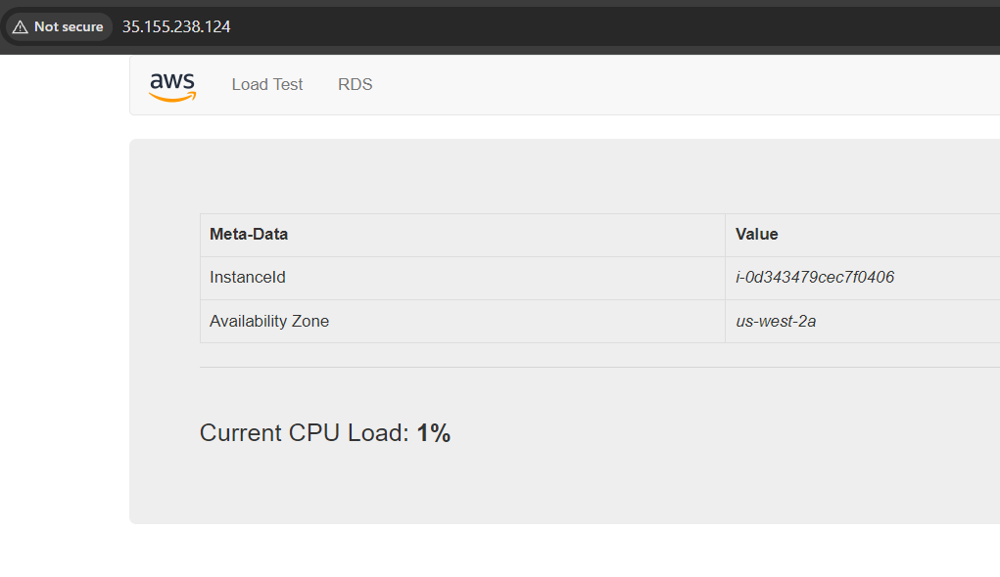

# Lab 267 - Create your VPC and Launch a Web Server

## Objetivo

Criar uma rede virtual na AWS, configurar sub-redes públicas e privadas e hospedar um servidor web acessível pela internet. O laboratório permite entender como os componentes de rede trabalham juntos para disponibilizar uma aplicação.

## Recursos criados

- **VPC:** `Lab VPC`, com bloco IPv4 `10.0.0.0/16`.
- **Sub-redes:** duas públicas e duas privadas, distribuídas conforme as configurações do laboratório.
- **Internet Gateway:** permite a comunicação entre a VPC e a internet.
- **NAT Gateway:** permite que recursos da rede privada iniciem conexões com a internet.
- **Tabelas de rotas:** definem para onde o tráfego de rede é encaminhado.
- **Security Group:** `Web Security Group`, permitindo acesso HTTP pela porta 80.
- **Instância EC2:** `Web Server 1`, com Amazon Linux 2023 e tipo `t3.micro`.

## Configuração da rede

A VPC utiliza o bloco IPv4 `10.0.0.0/16`. Foram configuradas quatro sub-redes:

| Sub-rede | Bloco IPv4 |
|---|---|
| Public Subnet 1 | `10.0.0.0/24` |
| Private Subnet 1 | `10.0.1.0/24` |
| Public Subnet 2 | `10.0.2.0/24` |
| Private Subnet 2 | `10.0.3.0/24` |

As sub-redes públicas foram associadas à tabela de rotas pública, enquanto as privadas foram associadas à tabela privada.

A tabela pública possui uma rota para `0.0.0.0/0` direcionada ao Internet Gateway. Na tabela privada, essa rota aponta para o NAT Gateway. Também foi identificada uma rota para um VPC Endpoint na tabela privada.

## Configuração do servidor web

A instância EC2 foi criada na `Public Subnet 2`, com endereço IPv4 público habilitado e o grupo de segurança `Web Security Group`.

O User Data executou os seguintes procedimentos durante a inicialização:

- Atualização dos pacotes com `dnf update -y`.
- Instalação do Apache (`httpd`), PHP e unzip.
- Download e extração dos arquivos da aplicação fornecida pelo laboratório.
- Ajuste das permissões dos arquivos para o usuário `apache`.
- Habilitação e inicialização do serviço Apache.

## Testes realizados

- A instância EC2 atingiu o estado `Running`.
- Os dois testes de status da instância foram aprovados.
- A página da aplicação foi aberta com sucesso no navegador usando o DNS público da instância.
- A tabela de rotas pública foi verificada e apresentou uma rota ativa para o Internet Gateway.
- A tabela de rotas privada foi verificada e apresentou uma rota ativa para o NAT Gateway e outra para o VPC Endpoint.

## Aprendizados

- Uma VPC é uma rede virtual isolada na AWS.
- Sub-redes dividem o espaço de endereços IP da VPC em redes menores.
- Uma sub-rede pública possui uma rota para o Internet Gateway; para um recurso ser acessível externamente, outras configurações também precisam permitir o acesso.
- O NAT Gateway permite que recursos de uma sub-rede privada iniciem conexões com a internet sem ficarem diretamente acessíveis por ela.
- As tabelas de rotas determinam o destino do tráfego de rede.
- Os Security Groups controlam o tráfego permitido para os recursos. Neste laboratório, a regra HTTP permite conexões pela porta 80.
- O User Data automatiza tarefas de configuração durante a inicialização da instância EC2.

## Captura de tela

A aplicação web foi aberta com sucesso no navegador usando o DNS público da instância EC2.

## Tecnologias utilizadas

- Amazon VPC
- Amazon EC2
- Internet Gateway
- NAT Gateway
- VPC Endpoint
- Security Groups
- Amazon Linux 2023
- Apache HTTP Server
- GitHub Pages
